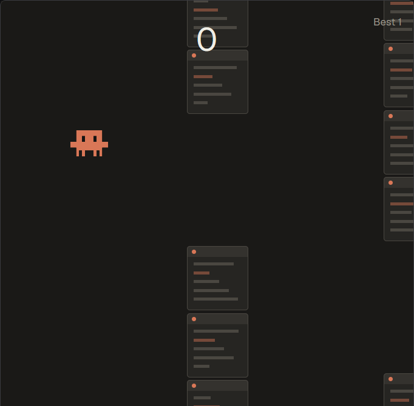

# Jumpy Critter

A one-button game to play while your agents work. Flap the little Claude character through the gaps between stacks of terminals.

A mod for the [Herdr](https://github.com/ogulcancelik/herdr) desktop app. It runs on the mod API alone. It was run in a real Herdr 0.1.13 window on Windows at zoom 1.2. It hasn't been run on macOS or Linux.

Copy `mods/jumpycritter` into `~/.config/herdr-app/mods` and merge `keys.json` into yours. `ctrl-shift-q` opens the game.

## How it plays

- `Space`, `W`, up or a click flaps. One point for each stack you clear.
- **A finished agent turn gives a shield,** up to three. A shield takes one crash.
- **A blocked agent shows a banner.** `G` goes to it and closes the game.
- The game pauses when it loses the keyboard.

## What it touches

It reads agent status, never terminal text. Your best score is in Herdr's shared state on this machine. It runs no programs, makes no network calls and reads no files outside its own folder.

## Art

The character is drawn pixel by pixel in `art/build.mjs`, which writes the PNGs with nothing but Node. It's Anthropic's Claude Code character, used here as a fan tribute. This project isn't made by or connected to Anthropic.

## Building

`node art/build.mjs` writes the art. `node --test` runs the tests.

MIT for the code, see `LICENSE`. The licence doesn't cover the character.
