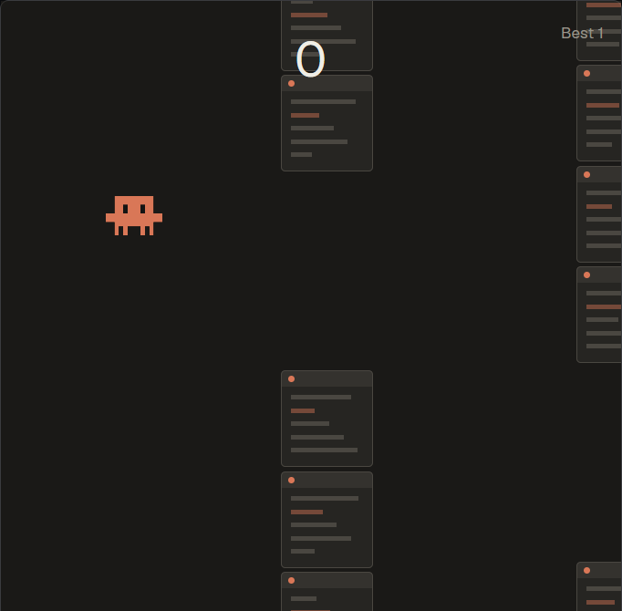

# Jumpy Critter

A one-button game in a dialog over the window. A small pixel character flaps through gaps between stacks of terminal windows, scrolling right to left, while your agents work.

## What you see

**The dialog**, 62% of the window wide and 94% tall, on `#1a1917`.

- **Stacks:** two columns of terminal cards per wall, above and below a 178 gap. Each card is 84 wide and 88 tall on `#262522`, radius 4, a `#4a4741` border, a 14 tall `#34322e` title bar with a 6px `#d97757` dot, and rows of 4 tall lines.
- **The character:** 52 wide at 96 from the left, `#d97757` with `#141413` eyes, 13 by 10 art pixels. Three frames: `down`, `up` while flapping, `hit` on a crash.
- **Score:** centred at the top, 44px `#f0eee6`. `Best N` at the top right, `Shields N` at the top left in `#d97757`.
- **Banner:** at 82 down on `#000000b0`, `An agent needs you. G to go.` in `#ff7b72`.
- **Screens:** `Jumpy Critter` before the first flap, `Context full` after a crash, `Paused` when it loses the keyboard.

## How it behaves

- **Keys:** `Space`, `W`, up or a click flaps. After a crash the same press starts again and flaps, and shields stay. A click that takes the keyboard back doesn't flap. `G` goes to the first blocked agent. `Esc` closes.
- **Physics:** gravity 1500, a flap sets speed to -430, walls move at 175 a second, 270 apart.
- **working:** no effect. **blocked:** the banner. **done or idle after working or blocked:** one shield, up to three.
- **A crash** on a wall or the floor uses a shield and gives 1.2 s of safety with the character blinking. With no shield the run ends. The ceiling stops you and doesn't hurt.

## Built from

- **One mod,** `mods/jumpycritter`, `{ "place": "none", "title": "Jumpy Critter", "focusable": true, "overlay": { "width": 0.62, "height": 0.94 } }`, opened by `mod.open`.
- **Files:** `game.js` the rules, `view.js` the drawing, `main.js` the loop. `art/build.mjs` writes the frames.
- **`herdr`:** `agents`, `closeOverlay`, `nextCommand`, `props`, `run` (`agent.focus`), `setShared` and `shared` (`jumpycritter.best`), `settings().zoom`.

## Watch out

- **A fixed overlay height can be taller than the window** at zoom 1.2. Give it as a share.
- **Key repeat:** ignore `is_held`, or holding a key flies straight up.
- **Sizes:** `on_size_change` reports window pixels. Divide by `settings().zoom`. A resize mid-run scales the character and walls, keeping every gap inside.

## Done when

- `herdr-app check` passes and `ctrl-shift-q` opens the game.
- `Space` flaps, clearing a stack adds 1, and hitting one shows `Context full` with the best score kept.
- A stand-in agent finishing a turn adds a shield, and the next crash uses it.
- A blocked agent shows the banner and `G` lands on its tab with the dialog closed.
- `node --test` passes.
